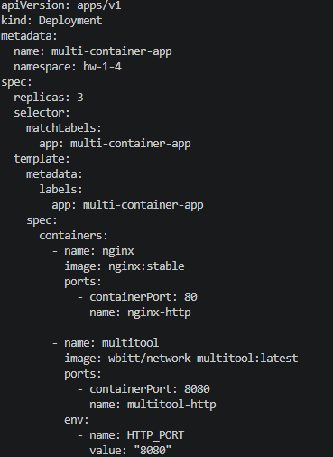
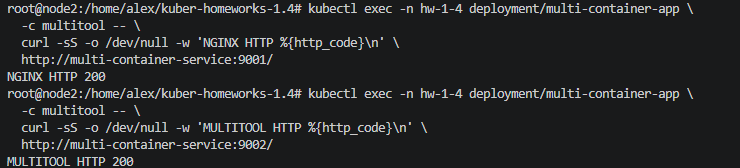
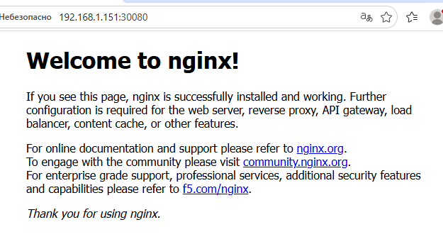
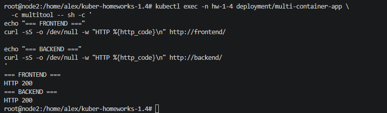
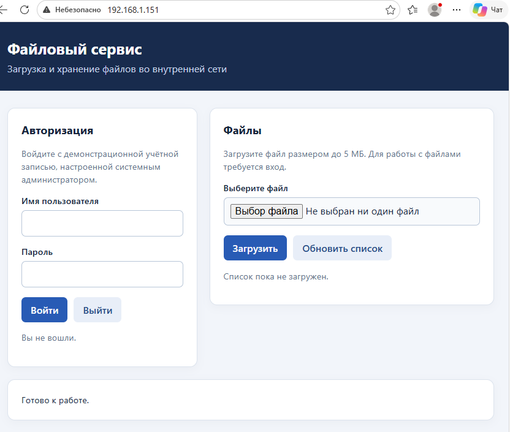
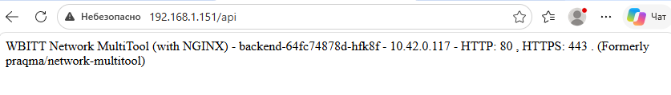

# Домашнее задание "Сетевое взаимодействие в Kubernetes"

В работе используется K3s вместо MicroK8s.
Установленный Ingress-контроллер Traefik
позволяет выполнить задания без установки MicroK8s.

## Задание 1. Настройка Service

### Шаг 1. Развёртываем Deployment

Благодарю тому, что мы в прошлой домашней работе устанавливали локально K3s, это дало нам небольшое преимущество.
K3s по умолчанию устанавливает Ingress-контроллер Traefik, который по заданию нам нужен.

Создаем Deployment multi-container-app.

Конфигурация:
- 3 реплики.
- 2 контейнера в каждом Pod.
- nginx: порт 80.
- network-multitool: порт 8080.

Для multitool переменная HTTP_PORT установлена
в 8080, чтобы избежать конфликта с nginx.

Манифест:


Проверка:

```
root@node2:/home/alex/kuber-homeworks-1.4# kubectl apply -f manifests/deployment-multi-container.yaml
deployment.apps/multi-container-app created
root@node2:/home/alex/kuber-homeworks-1.4# kubectl rollout status deployment/multi-container-app -n hw-1-4 --timeout=180s
kubectl get deployments,pods -n hw-1-4 -o wide
Waiting for deployment "multi-container-app" rollout to finish: 0 of 3 updated replicas are available...
Waiting for deployment "multi-container-app" rollout to finish: 1 of 3 updated replicas are available...
Waiting for deployment "multi-container-app" rollout to finish: 2 of 3 updated replicas are available...
deployment "multi-container-app" successfully rolled out
NAME                                  READY   UP-TO-DATE   AVAILABLE   AGE   CONTAINERS        IMAGES                                        SELECTOR
deployment.apps/multi-container-app   3/3     3            3           11s   nginx,multitool   nginx:stable,wbitt/network-multitool:latest   app=multi-container-app

NAME                                       READY   STATUS    RESTARTS   AGE   IP            NODE    NOMINATED NODE   READINESS GATES
pod/multi-container-app-655447bcd4-h2ckk   2/2     Running   0          11s   10.42.0.114   node2   <none>           <none>
pod/multi-container-app-655447bcd4-p65xf   2/2     Running   0          11s   10.42.0.112   node2   <none>           <none>
pod/multi-container-app-655447bcd4-vzjld   2/2     Running   0          11s   10.42.0.113   node2   <none>           <none>
```

Результат: Deployment содержит 3 работающих Pod
по 2 контейнера в каждом.

### Шаг 2. Настройка ClusterIP

Создаем service multi-container-service типа ClusterIP.

Настроена маршрутизация:
- Порт 9001 -> nginx:80
- Порт 9002 -> multitool:8080

Service направляет запросы на Pod с меткой:
"app: multi-container-app".

Проверку выполним из отдельного Pod с именем tst-pod внутри namespace hw-1-4:



Результаты:
- nginx: HTTP 200
- multitool: HTTP 200

Оба приложения доступны внутри кластера
через DNS-имя Service.

### Шаг 3. Настройка NodePort

Создаем service nginx-nodeport.

Конфигурация:
- Service port: 80
- Target port: 80
- NodePort: 30080
- Node IP: 192.168.1.151

NodePort предоставляет доступ к nginx снаружи
кластера по адресу:

http://192.168.1.151:30080



Проверку сделал через браузер Edge.

Результат: HTTP 200 OK, nginx доступен.

### Вывод по заданию 1

В Kubernetes настроены два типа Service:

1. ClusterIP обеспечивает внутренний доступ
   к nginx и multitool через порты 9001 и 9002.
2. NodePort предоставляет внешний доступ
   к nginx через порт 30080 узла Kubernetes.

Service использует selector для поиска Pod
и распределяет подключения между доступными
репликами приложения.

## Задание 2. Настройка Ingress

### Шаг 1. Развёртывание frontend и backend

Создаем два отдельных Deployment:

- frontend: nginx, 1 реплика, порт 80.
- backend: wbitt/network-multitool, 1 реплика, порт 80.

Для каждого Deployment создан Service типа ClusterIP.

Проверена доступность через DNS внутри Kubernetes:

```
=== FRONTEND ===
HTTP 200
=== BACKEND ===
HTTP 200
```



### Шаг 2. Настройка Ingress

Для маршрутизации HTTP-запросов используется Traefik, установленный вместе с K3s.
Создаем ingress app-ingress который будет направлять запросы:

- "/" -> service frontend -> nginx:80.
- "/api" -> service backen => network-multitool:80

Дополнительно используется Traefik Middleware strip-api, который удаляет префикс /api перед передачей запроса backend.


Проверяем состояние ресурсов:


```
root@node2:/home/alex/kuber-homeworks-1.4# kubectl get middleware -n hw-1-4
NAME        AGE
strip-api   2m46s
root@node2:/home/alex/kuber-homeworks-1.4# kubectl get deployments,pods,svc,ingress -n hw-1-4
NAME                                  READY   UP-TO-DATE   AVAILABLE   AGE
deployment.apps/backend               1/1     1            1           6m45s
deployment.apps/frontend              1/1     1            1           6m45s
deployment.apps/multi-container-app   3/3     3            3           44m

NAME                                       READY   STATUS    RESTARTS   AGE
pod/backend-64fc74878d-hfk8f               1/1     Running   0          6m45s
pod/frontend-7c9766d754-rvltv              1/1     Running   0          6m45s
pod/multi-container-app-655447bcd4-h2ckk   2/2     Running   0          44m
pod/multi-container-app-655447bcd4-p65xf   2/2     Running   0          44m
pod/multi-container-app-655447bcd4-vzjld   2/2     Running   0          44m

NAME                              TYPE        CLUSTER-IP      EXTERNAL-IP   PORT(S)             AGE
service/backend                   ClusterIP   10.43.245.58    <none>        80/TCP              6m38s
service/frontend                  ClusterIP   10.43.220.171   <none>        80/TCP              6m39s
service/multi-container-service   ClusterIP   10.43.107.190   <none>        9001/TCP,9002/TCP   29m
service/nginx-nodeport            NodePort    10.43.249.106   <none>        80:30080/TCP        12m

NAME                                    CLASS     HOSTS   ADDRESS         PORTS   AGE
ingress.networking.k8s.io/app-ingress   traefik   *       192.168.1.151   80      2m48s
```

Проверка доступности:

```
FRONTEND: HTTP 200
BACKEND: HTTP 200
```

Frontend: http://192.168.1.151/



Backend: http://192.168.1.151/api



### Вывод по заданию 2

Мы настроили ingress для двух приложений с маршрутизацией по URL путям. Оба приложение доступный через один ip адрес и стандартный порт 80. Для коррейтной работы пути /api используем Middleware Trafeik.

## Общий вывод

В ходе работы изучены и настроены ClusterIP, NodePort и Ingress. Проверены внутреннее взаимодействие Pod через Service, внешний доступ к nginx через NodePort и маршрутизация запросов к frontend и backend через Traefik.
